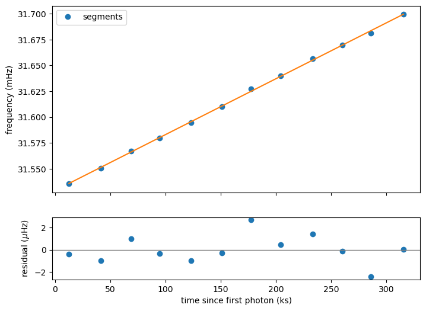
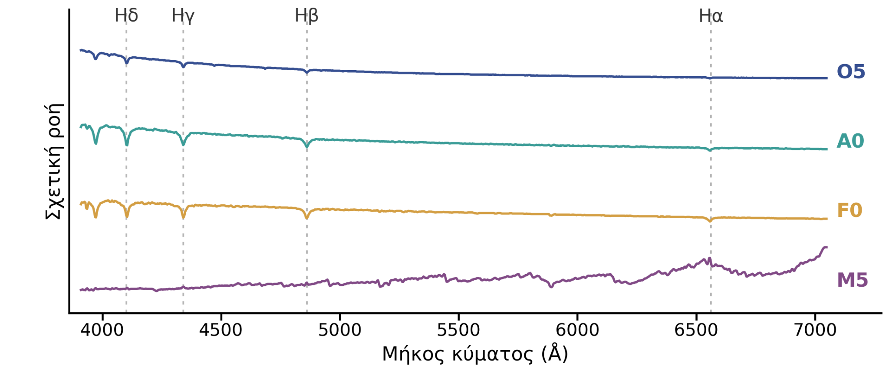

# Astrophysics Laboratory

**Elisavet Pavlidi · Department of Physics, NKUA · 2026–2027**

My completed astrophysics laboratory analyses, based on teaching notebooks by **Georgios Vasilopoulos ([gevas-astro](https://github.com/gevas-astro))**.

This collection contains my selected parameters, measurements, analysis extensions, figures and final reports. See [original notebook sources and teaching contributors](ACKNOWLEDGEMENTS.md) for attribution and source-specific permissions notes.

| Exercise | Analysis | Report |
| --- | --- | --- |
| [X-ray pulsar timing: NGC 300 ULX-1](labs/01_xray_pulsar/) | [Notebook](labs/01_xray_pulsar/analysis.ipynb) · [Uncertainties and sensitivity](labs/01_xray_pulsar/scripts/NGC300_ULX1_recalculate.py) | [PDF](labs/01_xray_pulsar/report/report.pdf) |
| [Stellar spectroscopy](labs/02_stellar_spectroscopy/) | [Runnable notebook](labs/02_stellar_spectroscopy/analysis.ipynb) · [Original work](labs/02_stellar_spectroscopy/source/) | [PDF](labs/02_stellar_spectroscopy/report/report.pdf) |

## X-ray pulsar timing

Period searches and spin-up measurements from NuSTAR data, followed by estimates of the accretion rate and neutron-star magnetic field.



## Stellar spectroscopy

Hα equivalent widths across spectral types O–M, continuum selection and an excitation-temperature estimate from Hδ and Paδ in F0.



## Run the analysis

Use Python 3.12 and create an environment from the repository root:

```bash
python3 -m venv .venv
source .venv/bin/activate
python -m pip install -r requirements.txt
python -m jupyterlab
```

Open the `analysis.ipynb` file inside either lab folder.

The spectroscopy notebook includes its 13 FITS templates and can run offline after installation. Rerunning the X-ray timing notebook requires the original barycentric event file; see its [data notes](labs/01_xray_pulsar/data/README.md). The saved timing outputs and reports are available without it.

The X-ray physical-parameter calculations can be rerun independently:

```bash
python labs/01_xray_pulsar/scripts/NGC300_ULX1_recalculate.py
```

## Notes

The reports are in Greek; these repository notes are in English. Student numbers have been removed from the repository copies. [Provenance and validation](docs/PROVENANCE.md) records the sources and preparation changes. Course scaffolding and third-party data are credited in [ACKNOWLEDGEMENTS.md](ACKNOWLEDGEMENTS.md).
