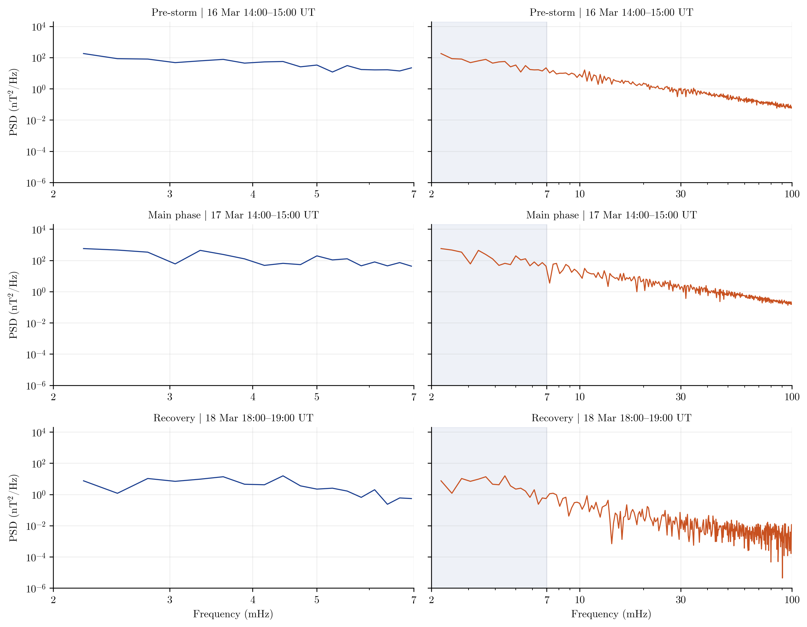
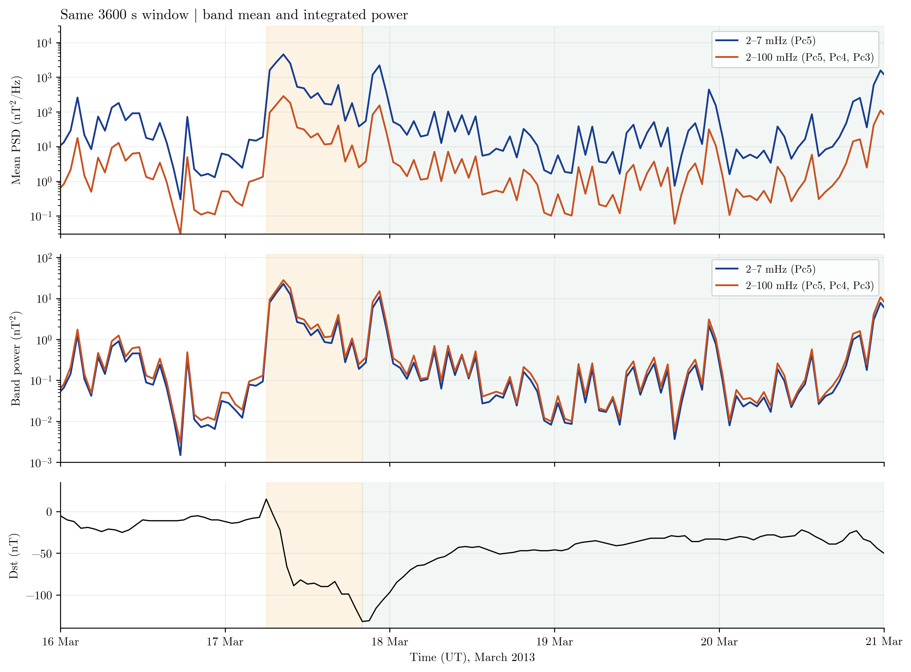
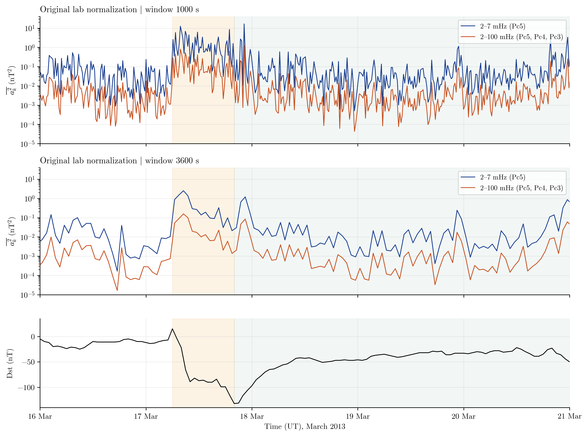
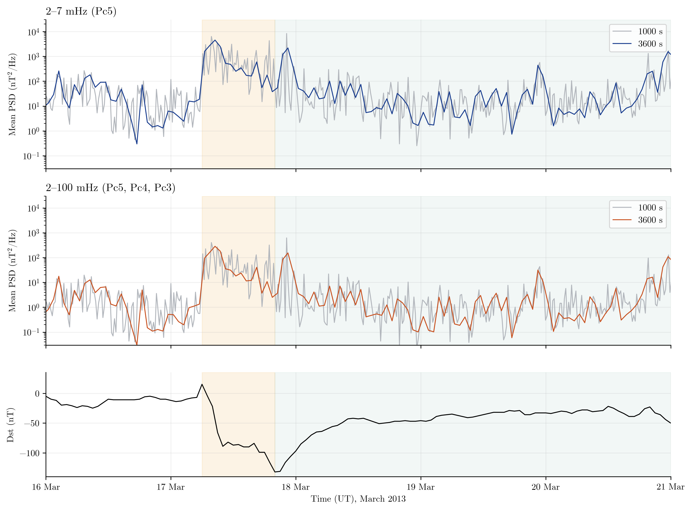

# Van Allen laboratory

**Elisavet Pavlidi · Department of Physics, NKUA · 2026–2027**

Geomagnetic variability and energetic electron spectra around the March 2013 storm, combining Fourier analysis of magnetic fluctuations with Van Allen Probes measurements.

[Read the full laboratory report (PDF)](report/report.pdf)

## Files

| File | Purpose |
| --- | --- |
| [Compare_Frequency_Bands.m](scripts/Compare_Frequency_Bands.m) | Compare frequency bands, time windows and storm phases; export figures and numerical results |
| [reproduce_analysis.py](scripts/reproduce_analysis.py) | Reproduce the Fourier tables, figures and electron-spectrum calculations in Python |
| [data/README.md](data/README.md) | Required input files and data conventions |
| [fourierSpectrum.m](scripts/matlab_helpers/fourierSpectrum.m) | Calculate squared Fourier amplitudes over a selected time interval and frequency range |
| [fourierPower.m](scripts/matlab_helpers/fourierPower.m) | Calculate mean squared Fourier amplitude in consecutive, non-overlapping windows |
| [report/report.pdf](report/report.pdf) | Written laboratory report in Greek |
| [figures/](figures/) | Saved Fourier figures and original electron spectra in PNG, PDF and JPEG |
| [results/](results/) | Fourteen processed CSV tables, numerical summary, column definitions and validation record |

The two Fourier helper functions are preserved unchanged from the course-provided MATLAB material.

## Input data

The MATLAB driver uses the original course file `GEOMAG.mat`, supplied separately. Place it inside `scripts/`. It must contain:

| Variable | Contents |
| --- | --- |
| `Bgr_time` | Magnetic-field timestamps as MATLAB datenums |
| `Bgr` | Magnetic-field series in nT, sampled once per second |
| `Dst_time` | Dst timestamps as MATLAB datenums |
| `Dst` | Dst index in nT |

The Fourier calculation assumes continuous one-second magnetic-field sampling. The selected time intervals are in UT.

The Python reproduction also uses `RBSP.mat` and `RBSPenergy.mat`; see the [input-data notes](data/README.md) for filenames and required variables.

## Run in MATLAB

Start MATLAB in the repository root, then run:

```matlab
cd('labs/03_van_allen/scripts')
Compare_Frequency_Bands
```

The driver adds `matlab_helpers/` to the MATLAB path automatically. MATLAB must support local functions in scripts and `exportgraphics`.

## Run in Python

Use Python 3.12 and install the [repository requirements](../../requirements.txt) in your environment. From the repository root:

```bash
python -m pip install -r requirements.txt
python labs/03_van_allen/scripts/reproduce_analysis.py --data-dir labs/03_van_allen/data
```

The input folder must contain `GEOMAG.mat`, `RBSP.mat` and `RBSPenergy.mat`. You can pass any folder containing those three files with `--data-dir`.

The default output folder is `labs/03_van_allen/generated/`:

- `computed/`: fourteen CSV tables and `summary.json`, including Fourier profiles, phase spectra, electron fluxes, power-law indices and a shared-`Lstar` comparison.
- `figures/`: four Fourier figures, each exported as PNG and vector PDF.

Use `--output-dir` to select another destination. The figures use Matplotlib's bundled DejaVu Serif font.

Run the analytical Fourier checks without the input data:

```bash
python labs/03_van_allen/scripts/reproduce_analysis.py --self-check
```

The full Python calculation was run against the supplied input files with Python 3.12.14, NumPy 2.3.5, SciPy 1.17.0 and Matplotlib 3.10.8. All fourteen CSV files matched the source archive byte for byte; the numerical summary also matched. Sinusoid and Parseval checks passed for even and odd sample counts.

## Analysis settings

Both frequency bands use identical time intervals and processing. The time profiles use windows of 3600 s and 1000 s over March–April 2013, with a separate view of 16–21 March alongside Dst.

The individual Fourier spectra use three equal one-hour intervals:

| Interval | Date | Time (UT) |
| --- | --- | --- |
| Before the storm | 16 March 2013 | 14:00–15:00 |
| Main phase | 17 March 2013 | 14:00–15:00 |
| Recovery phase | 18 March 2013 | 18:00–19:00 |

The original helper output is squared Fourier amplitude in nT², averaged over the selected frequency bins for the windowed profiles. It is distinct from a power spectral density in nT²/Hz and from integrated band power. The driver exports these quantities in separate columns. A wider frequency band need not have a larger **mean** squared amplitude.

## Saved results

The [results folder](results/) contains the final processed numerical outputs and their column definitions. The project's Python reproduction generates the fourteen CSV tables and [numerical summary](results/summary.json). The four Fourier comparison figures correspond to Figures 4–7 of the final report; the electron spectrum plots are also retained in that report.

### Fourier spectra across storm phases



[Vector PDF](figures/Bands_FFT_Phases.pdf) · [Six spectrum tables](results/README.md#phase-spectra)

### Hourly spectral density and integrated power



[Vector PDF](figures/Bands_HourlyPhysical.pdf) · [Hourly profile tables](results/README.md#hourly-profiles)

### Frequency-band comparison with mean squared amplitude



[Vector PDF](figures/Bands_OriginalNormalization.pdf) · [1000-second profile tables](results/README.md#1000-second-profiles)

This is Figure 4 of the final report. “Original normalization” identifies the amplitude-squared convention used for the comparison.

### Dependence on the time window



[Vector PDF](figures/Bands_WindowSensitivity.pdf) · [Window comparison and numerical summary](results/README.md#numerical-summary)

This is Figure 6 of the final report.

### Electron energy spectra

| Phase | Figure | Numerical table |
| --- | --- | --- |
| Before the storm | [Spectrum](figures/PreStorm_Spectrum.jpg) | [CSV](results/electrons/electron_Pre14.csv) |
| Main phase | [Spectrum](figures/MainPhase_Spectrum.jpg) | [CSV](results/electrons/electron_Main.csv) |
| Recovery | [Spectrum](figures/RecoveryPhase_Spectrum.jpg) | [CSV](results/electrons/electron_Recovery.csv) |

[Intervals, flux units and interpretation](results/electrons/README.md) · [12:00 start-time comparison](results/electrons/electron_Pre12.csv) · [Fit parameters and summary](results/summary.json) · [Full report](report/report.pdf)

## MATLAB outputs

The script creates `scripts/frequency_band_comparison/` containing:

- Fourier spectra for each interval and frequency band as CSV files.
- Time-profile tables with mean squared amplitude, mean power spectral density and integrated band power.
- Figures in PNG, vector PDF and MATLAB FIG formats.
- `Frequency_Band_Comparison_Results.mat` with the result structure.

Native MATLAB execution has not been verified in this environment.

